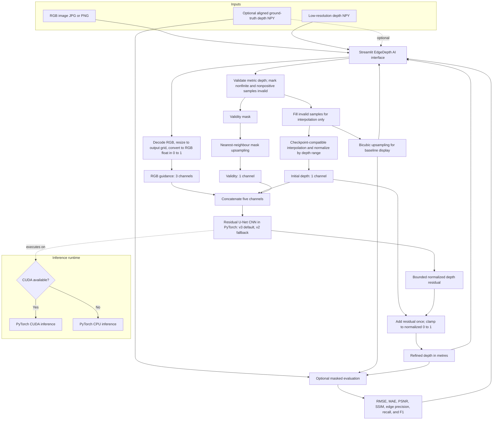

# EdgeDepth AI System Architecture

## Architecture diagram

## Data flow

1. The Streamlit interface accepts an RGB image and a low-resolution, single-channel `.npy` depth array. A high-resolution ground-truth depth array is optional and is only used to calculate metrics.
2. RGB is decoded in channel order RGB and converted to float values in `[0, 1]`. The output grid is the depth grid multiplied by the selected 2×, 4×, or 8× scale. Large inputs are bounded to a maximum output side of 512 pixels.
3. Depth is interpreted in metres. Finite positive samples are valid; NaN, infinite, and nonpositive samples are marked invalid. Invalid input samples are filled only to make interpolation possible; the validity mask retains where the sensor supplied data.
4. The app produces a bicubic upsampled baseline for display. CNN v3 uses bicubic initial depth, matching its NYU fine-tuning and evaluation path; the selectable v2 fallback retains the app's earlier bilinear input. Each initial depth is normalized by the loaded checkpoint's saved range (10 metres). The low-resolution validity mask is upsampled with nearest-neighbour interpolation.
5. RGB, initial depth, and validity mask are concatenated into five channels: RGB (3), initial depth (1), and validity (1). The loaded residual U-Net predicts a bounded normalized residual. The residual is added once to the initial depth and the final normalized depth is clamped to `[0, 1]` before conversion back to metres.
6. Inference runs on CUDA when PyTorch reports it available and otherwise on CPU. The checkpoint is loaded only after the user requests inference. NYU data is not required for app startup.
7. If ground truth is supplied, only finite positive reference pixels contribute to the app's RMSE, MAE, PSNR, SSIM, and edge precision, recall, and F1.

The five-channel model architecture is unchanged between v2 and v3. V2 was trained on procedural scenes and evaluated zero-shot on NYU. V3 was initialized from v2 and fine-tuned using NYU training data only; the NYU validation split selected its checkpoint. Its 100-sample comparison is a validation evaluation, not an independent test-set result. The standalone evaluators and app use the same loader and normalized output convention, converting normalized depth to metres once using the checkpoint range.
